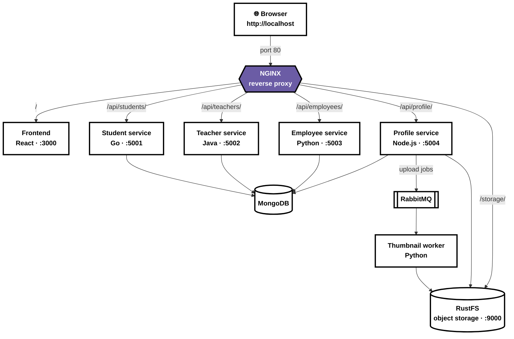

# Reverse Proxy (NGINX)
 
Added NGINX as a reverse proxy so all traffic goes through a single entry point on port 80. The frontend and backend services are no longer exposed on their own ports. The browser only talks to `http://localhost`, and NGINX routes each request to the right container over the Docker network.
 
## Diagram
 

 
## Routing
 
| Path | Upstream | Service | Backend receives |
|---|---|---|---|
| `/` | `frontend:3000` | Frontend | `/` |
| `/api/students/` | `studentservice:5001` | Student service | `/students` |
| `/api/teachers/` | `teacherservice:5002` | Teacher service | `/teachers` |
| `/api/employees/` | `employeeservice:5003` | Employee service | `/employees` |
| `/api/profile/` | `profileservice:5004` | Profile service | `/profile/...`, `/photos/...` |
| `/storage/` | `object-storage:9000` | RustFS (photo storage) | `/school-media/...` |
 
The trailing slash in `proxy_pass http://students/;` strips the `/api/students` prefix before the request reaches the service.
 
## Photo storage
 
Photos are kept in private buckets and served through short-lived signed URLs. The profile service sets `S3_PUBLIC_PATH=/storage`, so the browser gets links like `/storage/school-media/...`. NGINX strips `/storage` and sets `Host: object-storage:9000` so the signature still matches when RustFS checks it.
 
## Run and verify
 
```bash
docker compose up -d --build
curl -i http://localhost/api/students/students
```
 
Then open **http://localhost**.
 