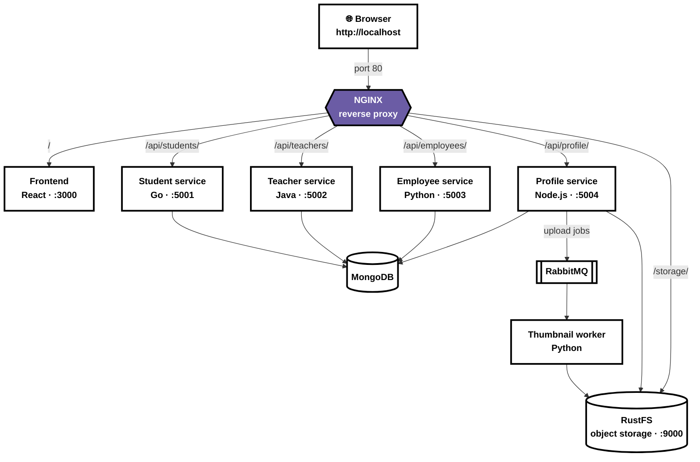

# Kindergarten Project — Run Locally

Run the frontend and APIs on your computer. Docker Compose runs MongoDB,
RabbitMQ, RustFS, and the MongoDB dashboard.


## Step 1: Prepare the project

Install Docker Compose, Node.js 22+, Go 1.23+, Python 3.13+, JDK 17, and Maven.
Open a terminal in the repository root.

Copy the example environment files:

- in every directory there is a .env.example, make it .env for the application to read it

- Set credentials in the root `.env`. Update each service's `.env` with matching
MongoDB, RabbitMQ, and RustFS credentials where required. Keep these files
private; do not commit credentials.

## Step 2: Start the supporting services

From the repository root, run:

```sh
docker compose up -d
docker compose ps
```

Open the MongoDB dashboard at [http://localhost:8081](http://localhost:8081).
Sign in with `MONGO_ROOT_USERNAME` and `MONGO_ROOT_PASSWORD` from `.env`.

Other consoles:

| Service | Address |
| --- | --- |
| RustFS | http://localhost:9001/rustfs/console/ |
| RabbitMQ | http://localhost:15672 |

Use the corresponding credentials in the root `.env`.

Every service below runs in its own terminal. Keep each one running.
Each service reads its own `.env` file from its folder, so always start it
from inside that folder.

## Step 3: Student service (Go, port 5001)

```sh
cd studentservice
go mod tidy
go run main.go
```

Check: http://localhost:5001/students returns a list (empty is fine).
## Step 4: Frontend (React, port 3000)

```sh
cd frontend
npm i
npm start
```

Open [http://localhost:3000](http://localhost:3000). API addresses default to
ports `5001`–`5004`; change them in `frontend/.env` and restart if needed.

## Step 5: Teacher service (Java, port 5002)

Requires **JDK 17** (newer versions break the build) and Maven.

In the teacher service terminal, point to JDK 17 and confirm it
(repeat in every new terminal):

```sh
mvn -version    # must show: Java version: 17
```

Build and run:

```sh
cd teacherservice
mvn clean package
java -jar target/teacherservice-1.0.0.jar
```

The first start downloads dependencies and can take a few minutes.
Check: http://localhost:5002/teachers returns a list.

## Step 6: Employee service (Python, port 5003)

```sh
cd employeeservice
pip install -r requirements.txt
python app.py
```

Check: http://localhost:5003/employees returns a list.

## Step 7: Profile (media) service (Node.js, port 5004)

Uploads photos to RustFS and queues thumbnail jobs in RabbitMQ.

```sh
cd profileservice
npm i
npm start
```

Check: http://localhost:5004/ready reports ready.

## Step 8: Thumbnail worker (Python)

Start it after the profile service. It turns uploaded photos into thumbnails.

```sh
cd thumbnailworker

pip install -r requirements.txt
python worker.py
```

Check: the terminal shows it is waiting for messages.


## Step 9: Verify everything

- The footer shows **3 of 3 services connected**.
- The Students, Teachers, and Employees tabs load and accept new records.
- A record with a photo shows **Processing**, then a thumbnail.
- The MongoDB dashboard shows the new records in the `kindergarten` database.

## Step 10: Run everything in Docker (containerized)

The whole project has been containerized. Every service has its own
`Dockerfile` and `.dockerignore`, and `docker-compose.yml` now starts the
frontend, all APIs, and the thumbnail worker together with MongoDB, RabbitMQ,
RustFS, and the MongoDB dashboard.

| Service | Base image | Port |
| --- | --- | --- |
| Frontend | `node:24` to build, `nginx` to serve | 3000 |
| Student service | `golang:1.23` | 5001 |
| Teacher service | `maven:3.9-eclipse-temurin-17` | 5002 |
| Employee service | `python:3.13-slim` | 5003 |
| Profile service | `node:22` | 5004 |
| Thumbnail worker | `python:3.13-slim` | — |

What changed:

- The frontend is built with `npm run build` and served by nginx.
- `.env` files are not copied into the images. Docker Compose passes each
service's `.env` in when the container starts (`env_file`).
- Inside Docker, each service's `.env` must use the container names as hosts:
`mongo:27017`, `rabbitmq:5672`, and `object-storage:9000` (not `localhost`).
- Backend services wait for MongoDB (and RabbitMQ and RustFS where needed) to
be healthy before starting, and restart automatically if they fail.

From the repository root, run:

```sh
docker compose up -d --build
docker compose ps
```

Wait about 30 seconds, then open [http://localhost:3000](http://localhost:3000).

If a service is not working, check its logs:

```sh
docker compose logs <service-name>
```

Stop everything:

```sh
docker compose down
```

Note: when everything runs in Docker, do not start the services from Steps
3–8 at the same time, because ports `3000` and `5001`–`5004` are already in use.

## Step 11: Add NGINX as a reverse proxy
 
NGINX now sits in front of the whole project as the single entry point on
port `80`. The browser only talks to [http://localhost](http://localhost), and
NGINX routes each request to the right container over the Docker network. The
frontend and API ports (`3000`, `5001`–`5004`) are no longer published.
 

 
| Path | Upstream | Service | Backend receives |
| --- | --- | --- | --- |
| `/` | `frontend:3000` | Frontend | `/` |
| `/api/students/` | `studentservice:5001` | Student service | `/students` |
| `/api/teachers/` | `teacherservice:5002` | Teacher service | `/teachers` |
| `/api/employees/` | `employeeservice:5003` | Employee service | `/employees` |
| `/api/profile/` | `profileservice:5004` | Profile service | `/profile/...`, `/photos/...` |
| `/storage/` | `object-storage:9000` | RustFS (photo storage) | `/school-media/...` |
 
What changed:
 
- `frontend/.env` points the APIs at NGINX paths instead of ports:
`/api/students`, `/api/teachers`, `/api/employees`, `/api/profile`. Rebuild
the frontend after changing it, because these values are built into the app.
- The trailing slash in `proxy_pass http://students/;` strips the `/api/...`
prefix before the request reaches the service.
- Photos stay in private buckets and are served through signed URLs. The
profile service sets `S3_PUBLIC_PATH=/storage`, and NGINX sets
`Host: object-storage:9000` so the signature still matches.
- `S3_ENDPOINT` stays `http://object-storage:9000` in the profile service and
thumbnail worker, because they talk to RustFS directly inside Docker.
- `client_max_body_size 10M` allows photo uploads up to 5 MB.
From the repository root, run:
 
```sh
docker compose up -d --build
docker ps
```
 
Open [http://localhost](http://localhost).
 
Check: `curl -i http://localhost/api/students/students` returns a list, and
the footer shows **3 of 3 services connected**.
 
